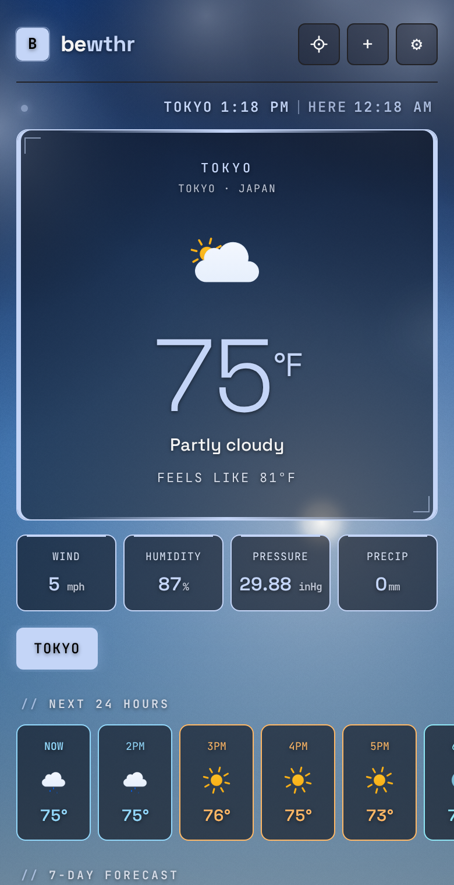
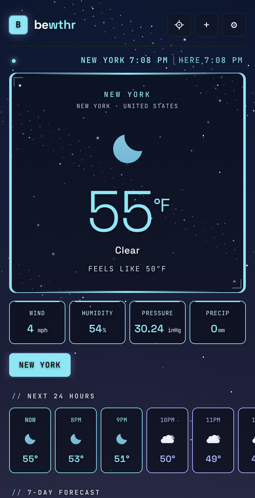
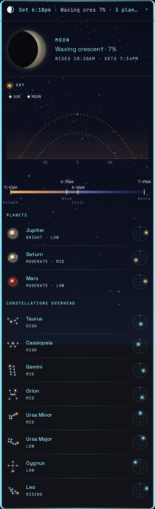
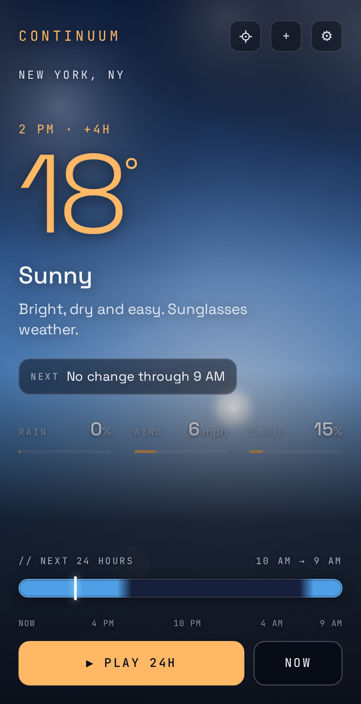
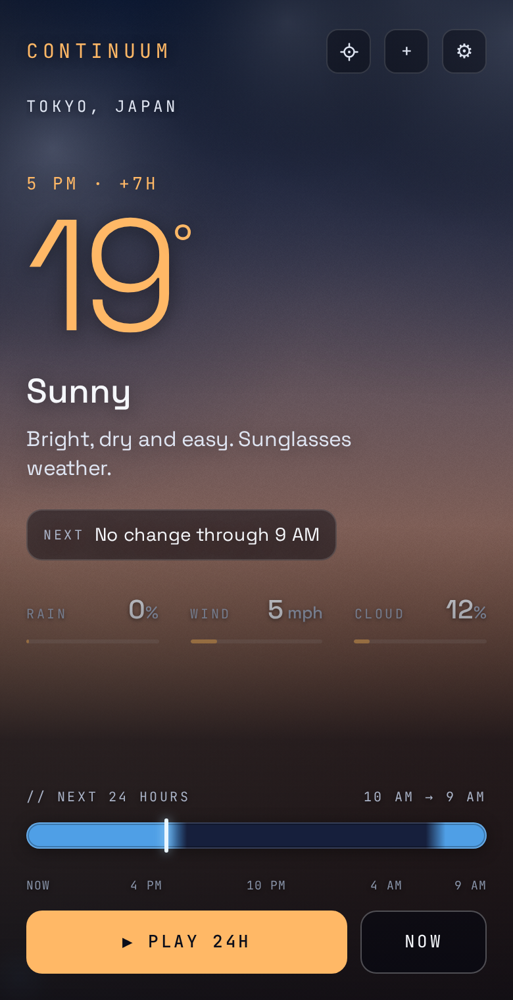
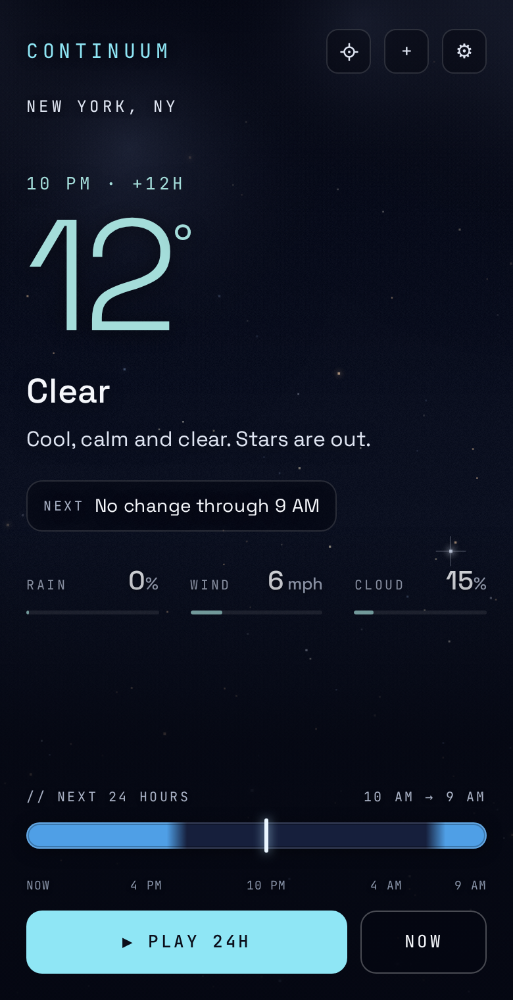
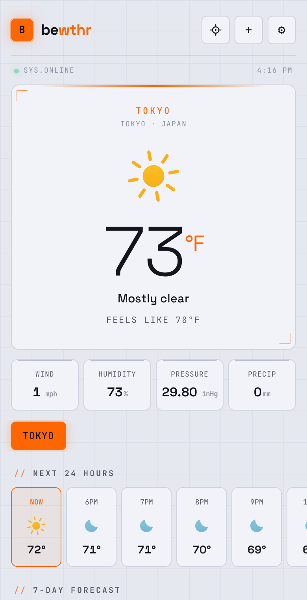
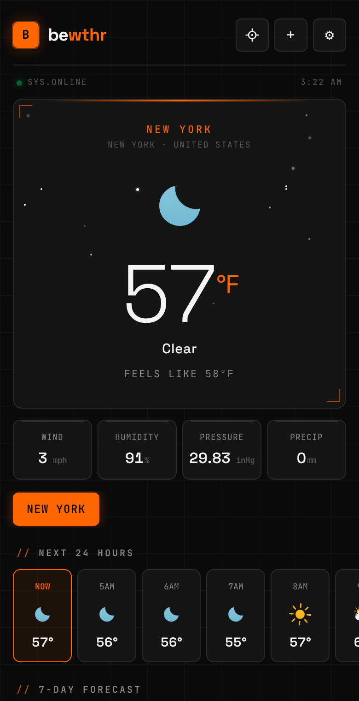
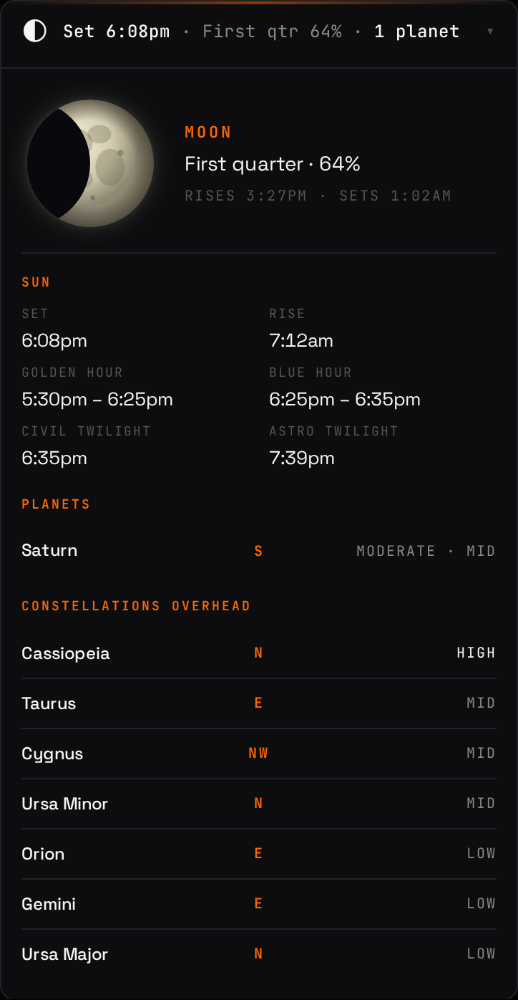

<div align="center">

# 🌦️ bewthr

### The weather, shown as a real, living sky.

*No accounts, no sign-up, no ads — and your exact location never leaves your device.*

**▶ Open it — [codereimagine.github.io/bewthr](https://codereimagine.github.io/bewthr/)**

$\textcolor{#22d3ee}{\textsf{IMAGINED}}$ — the full living sky
<p>
  
  
  
</p>

$\textcolor{#d946ef}{\textsf{CONTINUUM}}$ — scrub or play a full day of sky
<p>
  
  
  
</p>

$\textcolor{#f5a623}{\textsf{CLASSIC}}$ — a clean, minimal instrument view
<p>
  
  
  
</p>

<sub>By <b>Bert Peters</b> · the weather axis of <a href="https://github.com/codereimagine">codereimagine</a></sub>

</div>

---

## 🌤️ What is it?

bewthr tells you the weather — but instead of a wall of numbers, it shows you the **actual sky** for exactly where you are, right now. Daytime, the app is bright; at night it goes dark and the stars come out. The moon shows its real shape for tonight. If it's raining outside, rain falls on the screen. It's the weather you can just *look at*.

No app store, no account, nothing to sign up for. Open the link and it works. Like it? Add it to your home screen like any other app.

## ✨ How we do things differently

Most apps want your account, your data, and your attention. Every codereimagine app is built the other way round:

- **Private by default** — no accounts, no tracking, nothing sold. Your exact location stays on *your* device.
- **No ads, no clutter** — nothing on the screen is trying to sell you something.
- **Yours to keep** — installs like an app and keeps working offline, even on a weak signal.
- **Fully open & free** — the whole thing is public (Apache-2.0). Nothing hidden.
- **Made to feel good** — an everyday tool should be beautiful, not just functional.

## 👀 What you can do with it

- **Today at a glance** — temperature, rain, and the sky in one calm screen.
- **Tonight's sky** — where the sun and moon rise and set, when golden hour and dusk happen, and which planets and stars are overhead.
- **Play the whole day** — scrub or hit Play and watch the next 24 hours of sky flow by, sunrise to midnight.
- **Pick your look** — a rich "living sky", a scrub-the-day timeline, or a clean, simple view. One tap to switch.
- **Anywhere** — fast on phones and computers.

## 🛠️ Run or build it yourself (developers)

```bash
git clone https://github.com/codereimagine/bewthr.git
cd bewthr && npm install
npm run dev        # local dev server
npm run build      # production build → dist/
npm run preview    # preview the production build
npm test           # unit tests
```

<details><summary><b>🔧 Under the hood</b></summary>

- **Weather:** keyless — Open-Meteo with a MET.no fallback, plus NWS alerts. No API keys.
- **Astronomy:** sun/moon/planet/constellation positions computed on-device with [`astronomy-engine`](https://github.com/cosinekitty/astronomy) — the sun and moon follow their true altitude *and* azimuth, so their paths genuinely differ.
- **Privacy:** precise coordinates live in on-device storage; egress is rounded (≈1 km "surrounding" by default, selectable to ≈11 km "general", or exact). If browser GPS is blocked, it falls back to approximate network location — no prompt required.
- **Rendering:** layered HTML canvas — a compositor-cached static sky layer with a light animated precipitation layer on top, for smooth, battery-friendly motion.
- **Accessibility:** WCAG-audited contrast over the animated sky; dark / light / night / auto themes; reduced-motion support.
- **Stack:** React 19 · TypeScript · Vite · Canvas 2D · `astronomy-engine` · Zustand · vite-plugin-pwa

</details>

## 🙌 Credits & thanks

Built with [Claude Code](https://claude.com/claude-code). Nothing here is hidden — bewthr stands on:

- **Weather data** — [Open-Meteo](https://open-meteo.com) (CC BY 4.0) · [MET Norway](https://www.met.no/en) · US National Weather Service.
- **Astronomy** — [`astronomy-engine`](https://github.com/cosinekitty/astronomy) (MIT) by Don Cross.
- **Fonts** — Space Grotesk & JetBrains Mono (SIL Open Font License 1.1).
- **Emoji** — standard Unicode, drawn by your device.

## 📄 License

Apache-2.0 — see [LICENSE](LICENSE).
